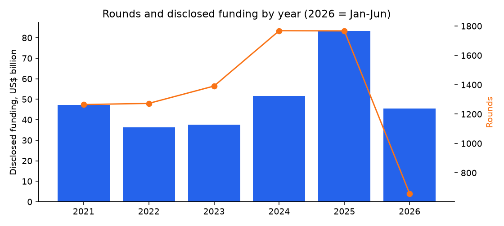
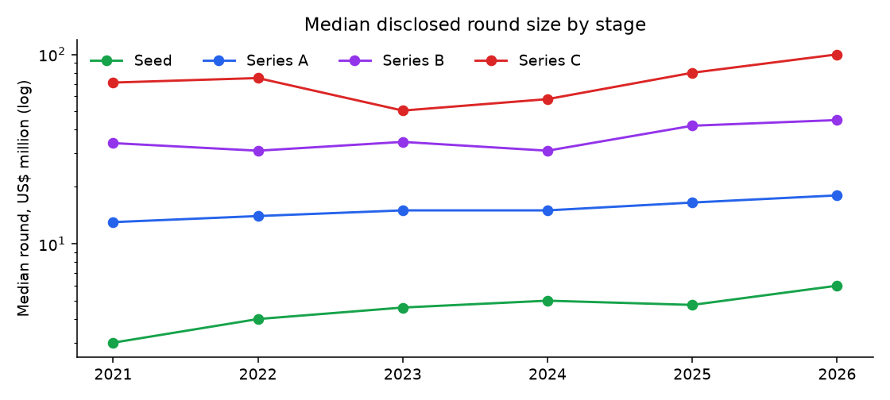
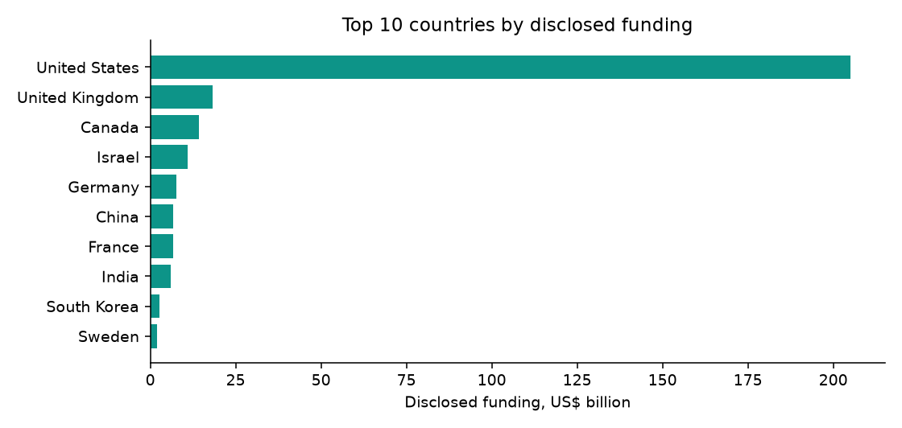

# AI Startup Funding Rounds 2021–2026: findings, method and data card

*Fliar Research · released October 2026 · licence CC BY-NC 4.0*

**How this dataset was acquired.** Every row comes from the [Radar API](https://github.com/fliarbi/radar-api-mcp), Fliar's company-data API and MCP server. Radar reads
business news continuously and extracts each funding announcement into structured fields: company, stage, amount, currency, investors
and date. It then links the company to its record in a database of five million companies. This release covers AI companies worldwide, January 2021 to June 2026. It runs that
output through a reproducible cleaning pipeline: repeated reports of one deal are merged, recaps of past rounds are dropped, and every
amount is checked against the sentence it was read from. Each row names the article it was read from (`news_source`, `news_url`) and
quotes the sentence (`news_excerpt`). The full, continuously updated data is available through `POST /v1/companies/funding`
([reference](https://github.com/fliarbi/radar-api-mcp/blob/main/docs/reference/get_company_funding.md)) or the `get_company_funding` MCP tool.

> **This file is a 62% sample: 5,000 of 8,122 funding rounds.** It keeps every record for a fixed subset of companies.
> The subset is chosen by a hash, so it stays the same from one release to the next. The findings and tables below were computed
> on the **full** data. For the rest, the withheld fields and monthly updates, [get a Radar API key](https://fliarbi.com/radar-api/developer) ([docs](https://github.com/fliarbi/radar-api-mcp)).
> Each row's `fliar_profile_url` opens the company's full profile on Fliar.

## Key findings

1. **5,412 companies raised 8,122 rounds between 2021 and mid-2026.** 6,974 rounds disclosed an amount, totalling $301.5B.
2. **2024 was the busiest year**, with 1,768 rounds. Disclosed funding in 2025 was $83.2B, 1.8× the 2021 level ($47.3B).
3. **Mega-rounds dominate the dollars.** Rounds of US$100M or more are 11% of rounds with a disclosed amount, but 67% of disclosed dollars.
4. **Early rounds got bigger.** The median Seed round went from $3.0M in 2021 to $4.8M in 2025; the median Series A from $13.0M to $16.5M.
5. **Funding is concentrated.** The top three countries (United States, United Kingdom, Canada) hold 79% of disclosed dollars.
6. **The fastest-rising sectors** (share of rounds, 2021–2022 vs 2024–2025): Business Services (3.8% → 6.0%), Enterprise Infrastructure (6.3% → 8.5%), Consumer (2.6% → 3.9%).

### Funding by year

Full data. 2026 covers January to June.

| Year           | Rounds   | Companies   | With amount   | Disclosed $   | Median round   | Rounds ≥ $100M   | Share of $ in ≥ $100M rounds   |
|:---------------|:---------|:------------|:--------------|:--------------|:---------------|:-----------------|:-------------------------------|
| 2021           | 1,265    | 1,099       | 1,112         | $47.3B        | $12.0M         | 144              | 65.4%                          |
| 2022           | 1,273    | 1,160       | 1,128         | $36.4B        | $10.0M         | 93               | 53.9%                          |
| 2023           | 1,391    | 1,212       | 1,184         | $37.6B        | $7.5M          | 100              | 60.7%                          |
| 2024           | 1,768    | 1,549       | 1,502         | $51.5B        | $8.6M          | 129              | 61.7%                          |
| 2025           | 1,767    | 1,557       | 1,513         | $83.2B        | $13.6M         | 201              | 70.9%                          |
| 2026 (Jan–Jun) | 658      | 622         | 535           | $45.5B        | $18.4M         | 101              | 80.0%                          |

### Round size by stage

| Stage            | Rounds   | Disclosed $   | 25th pct   | Median   | 75th pct   | Median 2021   | Median 2025   |
|:-----------------|:---------|:--------------|:-----------|:---------|:-----------|:--------------|:--------------|
| Seed             | 1,722    | $9.2B         | $2.5M      | $4.3M    | $7.0M      | $3.0M         | $4.8M         |
| Series A         | 1,446    | $27.9B        | $10.0M     | $15.0M   | $24.0M     | $13.0M        | $16.5M        |
| Series B         | 802      | $38.5B        | $23.0M     | $38.0M   | $57.8M     | $34.0M        | $42.0M        |
| Pre-seed         | 464      | $745.7M       | $701.5K    | $1.5M    | $2.3M      | $700.0K       | $1.7M         |
| Series C         | 400      | $47.2B        | $44.0M     | $73.0M   | $120.0M    | $71.0M        | $80.0M        |
| Series D         | 178      | $32.2B        | $86.8M     | $125.0M  | $228.5M    | $135.0M       | $140.0M       |
| Growth / PE      | 172      | $15.5B        | $15.1M     | $40.0M   | $105.0M    | $54.5M        | $50.0M        |
| Pre-Series A     | 146      | $434.4M       | $1.3M      | $3.0M    | $4.5M      | $1.7M         | $4.2M         |
| Strategic        | 130      | $3.2B         | $6.0M      | $14.0M   | $50.0M     | $42.5M        | $22.0M        |
| Grant            | 96       | $478.8M       | $168.8K    | $976.0K  | $2.5M      | $998.5K       | $1.3M         |
| Series E         | 81       | $22.2B        | $110.5M    | $203.0M  | $350.0M    | $200.0M       | $245.0M       |
| Debt             | 60       | $2.8B         | $11.0M     | $32.0M   | $83.8M     | $4.0M         | $60.0M        |
| Series F         | 44       | $17.4B        | $150.0M    | $250.0M  | $475.0M    | $220.0M       | $217.5M       |
| Angel            | 31       | $31.9M        | $330.0K    | $635.0K  | $1.8M      | $340.5K       | $1.4M         |
| Convertible note | 27       | $773.6M       | $1.8M      | $4.0M    | $49.5M     | $3.8M         | $47.9M        |
| Bridge           | 16       | $34.0M        | $1.2M      | $1.9M    | $2.8M      | $1.6M         | $2.4M         |
| Series G         | 10       | $11.7B        | $314.8M    | $500.0M  | $1.1B      | $300.0M       | $800.0M       |
| Crowdfunding     | 9        | $6.3M         | $489.2K    | $962.5K  | $1.8M      | $1.5M         |               |
| Pre-Series B     | 9        | $91.9M        | $12.1M     | $13.8M   | $17.6M     |               | $10.5M        |
| Venture debt     | 8        | $163.3M       | $7.1M      | $16.2M   | $25.0M     |               | $18.1M        |
| Series H         | 4        | $1.6B         | $1.6B      | $1.6B    | $1.6B      | $1.6B         |               |
| Pre-Series D     | 1        | $30.0M        | $30.0M     | $30.0M   | $30.0M     |               |               |

### Most active investors (top 50)

Rounds each investor joined, full data. Organisations only; aliases such as "Accel" and "Accel Partners" are merged.

| #   | Investor                               | Rounds   | As lead / first named   | Companies   | Disclosed $ in rounds joined   | Median round   | Most common stage   | Top sector              | Active    |
|:----|:---------------------------------------|:---------|:------------------------|:------------|:-------------------------------|:---------------|:--------------------|:------------------------|:----------|
| 1   | Y Combinator                           | 253      | 40                      | 203         | $6.6B                          | $12.0M         | Seed                | Enterprise Applications | 2021–2026 |
| 2   | Insight Partners                       | 181      | 92                      | 129         | $24.3B                         | $50.0M         | Series A            | Enterprise Applications | 2021–2026 |
| 3   | Sequoia Capital                        | 173      | 58                      | 111         | $23.0B                         | $54.0M         | Series A            | High Tech               | 2021–2026 |
| 4   | Andreessen Horowitz                    | 170      | 67                      | 97          | $27.4B                         | $60.0M         | Series A            | High Tech               | 2021–2026 |
| 5   | Lightspeed Venture Partners            | 145      | 50                      | 93          | $30.7B                         | $60.0M         | Series B            | High Tech               | 2021–2026 |
| 6   | Accel                                  | 143      | 72                      | 102         | $20.6B                         | $39.0M         | Series A            | High Tech               | 2021–2026 |
| 7   | Nvidia                                 | 132      | 34                      | 75          | $44.1B                         | $200.0M        | Series B            | High Tech               | 2021–2026 |
| 8   | Tiger Global                           | 128      | 44                      | 85          | $22.0B                         | $100.0M        | Series C            | High Tech               | 2021–2026 |
| 9   | Khosla Ventures                        | 107      | 40                      | 70          | $6.8B                          | $32.5M         | Series A            | High Tech               | 2021–2026 |
| 10  | Bessemer Venture Partners              | 98       | 36                      | 78          | $13.0B                         | $35.0M         | Series B            | Enterprise Applications | 2021–2026 |
| 11  | Coatue                                 | 95       | 16                      | 54          | $29.1B                         | $102.5M        | Series B            | High Tech               | 2021–2026 |
| 12  | Index Ventures                         | 93       | 36                      | 67          | $10.3B                         | $50.0M         | Seed                | Enterprise Applications | 2021–2026 |
| 13  | Google                                 | 92       | 28                      | 73          | $16.3B                         | $67.5M         | Series C            | High Tech               | 2021–2026 |
| 14  | Salesforce Ventures                    | 84       | 14                      | 62          | $13.4B                         | $78.0M         | Series B            | High Tech               | 2021–2026 |
| 15  | Alumni Ventures                        | 72       | 1                       | 65          | $3.1B                          | $15.5M         | Series A            | High Tech               | 2021–2026 |
| 16  | Kleiner Perkins                        | 71       | 19                      | 42          | $8.5B                          | $79.5M         | Series C            | Enterprise Applications | 2021–2026 |
| 17  | Menlo Ventures                         | 64       | 18                      | 41          | $14.3B                         | $50.0M         | Series B            | High Tech               | 2021–2026 |
| 18  | Intel Capital                          | 63       | 18                      | 48          | $7.6B                          | $45.5M         | Series A            | High Tech               | 2021–2026 |
| 19  | 8Vc                                    | 62       | 13                      | 46          | $8.1B                          | $36.0M         | Series A            | Enterprise Applications | 2021–2026 |
| 20  | Nea                                    | 61       | 31                      | 46          | $4.3B                          | $36.4M         | Series A            | High Tech               | 2021–2026 |
| 21  | Founders Fund                          | 60       | 18                      | 39          | $18.2B                         | $67.0M         | Series A            | High Tech               | 2021–2026 |
| 22  | Bain Capital Ventures                  | 59       | 16                      | 43          | $6.1B                          | $40.0M         | Series B            | Enterprise Applications | 2021–2026 |
| 23  | Madrona Venture Group                  | 59       | 25                      | 42          | $2.8B                          | $21.0M         | Seed                | Enterprise Applications | 2021–2026 |
| 24  | Microsoft                              | 57       | 17                      | 27          | $14.7B                         | $102.5M        | Series B            | High Tech               | 2021–2026 |
| 25  | Lux Capital                            | 55       | 13                      | 39          | $6.8B                          | $40.0M         | Series A            | High Tech               | 2021–2026 |
| 26  | Thrive Capital                         | 52       | 18                      | 20          | $11.2B                         | $100.0M        | Series A            | High Tech               | 2021–2026 |
| 27  | Valor Equity Partners                  | 49       | 11                      | 31          | $11.5B                         | $89.7M         | Series B            | High Tech               | 2021–2026 |
| 28  | Felicis                                | 49       | 22                      | 37          | $3.4B                          | $37.0M         | Series A            | Enterprise Applications | 2021–2026 |
| 29  | Greylock                               | 49       | 17                      | 30          | $3.6B                          | $43.0M         | Series A            | High Tech               | 2021–2026 |
| 30  | Gaingels                               | 48       | 2                       | 47          | $3.2B                          | $15.0M         | Seed                | Enterprise Applications | 2021–2026 |
| 31  | Techstars                              | 48       | 4                       | 42          | $369.0M                        | $4.5M          | Seed                | Enterprise Applications | 2021–2026 |
| 32  | Citi Ventures                          | 47       | 6                       | 36          | $3.5B                          | $60.0M         | Series B            | Enterprise Applications | 2021–2026 |
| 33  | Spark Capital                          | 46       | 11                      | 32          | $5.5B                          | $44.0M         | Series B            | High Tech               | 2021–2026 |
| 34  | Blackrock                              | 46       | 9                       | 30          | $21.3B                         | $200.0M        | Series F            | High Tech               | 2021–2026 |
| 35  | Redpoint Ventures                      | 45       | 11                      | 34          | $3.5B                          | $55.0M         | Series A            | Enterprise Applications | 2021–2026 |
| 36  | Greycroft                              | 45       | 13                      | 41          | $2.3B                          | $25.6M         | Series A            | Enterprise Applications | 2021–2026 |
| 37  | Craft Ventures                         | 45       | 18                      | 34          | $2.0B                          | $15.1M         | Series A            | High Tech               | 2021–2025 |
| 38  | Battery Ventures                       | 44       | 17                      | 31          | $3.3B                          | $45.0M         | Series B            | Enterprise Applications | 2021–2026 |
| 39  | SV Angel                               | 44       | 1                       | 35          | $2.9B                          | $30.0M         | Series A            | High Tech               | 2021–2026 |
| 40  | Gradient Ventures                      | 42       | 18                      | 33          | $880.4M                        | $10.0M         | Seed                | High Tech               | 2021–2026 |
| 41  | Seedcamp                               | 42       | 7                       | 35          | $855.0M                        | $10.0M         | Series A            | Enterprise Applications | 2021–2026 |
| 42  | Amplify Partners                       | 42       | 11                      | 29          | $2.9B                          | $40.0M         | Series C            | High Tech               | 2021–2026 |
| 43  | Antler                                 | 41       | 9                       | 35          | $339.2M                        | $2.1M          | Pre-seed            | Enterprise Applications | 2021–2026 |
| 44  | Qualcomm Ventures                      | 40       | 8                       | 31          | $4.4B                          | $70.8M         | Series D            | High Tech               | 2021–2026 |
| 45  | Norwest Venture Partners               | 40       | 13                      | 29          | $2.5B                          | $32.5M         | Series B            | Enterprise Applications | 2021–2026 |
| 46  | Fidelity Management & Research Company | 39       | 8                       | 24          | $16.3B                         | $200.0M        | Series D            | High Tech               | 2021–2026 |
| 47  | Softbank                               | 38       | 16                      | 22          | $7.4B                          | $107.0M        | Series E            | High Tech               | 2021–2026 |
| 48  | Temasek                                | 38       | 10                      | 28          | $6.9B                          | $105.5M        | Series C            | High Tech               | 2021–2026 |
| 49  | Point72 Ventures                       | 38       | 9                       | 24          | $4.5B                          | $41.0M         | Seed                | High Tech               | 2021–2026 |
| 50  | B Capital                              | 38       | 9                       | 24          | $2.4B                          | $47.5M         | Series B            | High Tech               | 2021–2026 |

### Largest disclosed rounds (top 50)

| #   | Company               | Stage       | Date       | Amount   | Lead investor                                | Investors   | Sector                               | Location                     |
|:----|:----------------------|:------------|:-----------|:---------|:---------------------------------------------|:------------|:-------------------------------------|:-----------------------------|
| 1   | Anthropic             | Series G    | 2026-03-24 | $5.0B    | Amazon                                       | 45          | High Tech                            | San Francisco, United States |
| 2   | Anthropic             | Series F    | 2025-08-23 | $3.8B    | Lightspeed Venture Partners                  | 22          | High Tech                            | San Francisco, United States |
| 3   | Anduril               | Series G    | 2025-06-05 | $2.5B    | Founders Fund                                | 1           | High Tech                            | Costa Mesa, United States    |
| 4   | Anysphere             | Series D    | 2025-11-14 | $2.3B    | Accel                                        | 4           | High Tech                            | San Francisco, United States |
| 5   | Mistral AI            | Series C    | 2025-08-04 | $2.2B    | Asml                                         | 19          | High Tech                            | Paris, France                |
| 6   | OpenAI                | Growth / PE | 2026-04-06 | $2.0B    | Robinhood Ventures Fund I                    | 36          | High Tech                            | San Francisco, United States |
| 7   | Nscale                | Series C    | 2026-02-26 | $2.0B    | Nvidia                                       | 11          | Enterprise Infrastructure            | London, United Kingdom       |
| 8   | xAI                   | Series E    | 2026-01-05 | $2.0B    | Tesla                                        | 17          | High Tech                            | Memphis, United States       |
| 9   | Nscale                | Series C    | 2023-06-22 | $2.0B    | 8090 Industries                              | 6           | Enterprise Infrastructure            | London, United Kingdom       |
| 10  | Saronic               | Series D    | 2026-04-03 | $1.8B    | Kleiner Perkins                              | 6           | Aerospace, Maritime and Defense Tech | Austin, United States        |
| 11  | Databricks            | Series H    | 2021-08-30 | $1.6B    | Morgan Stanley's Counterpoint Global         | 31          | Enterprise Infrastructure            | San Francisco, United States |
| 12  | Lambda Labs           | Series E    | 2025-11-18 | $1.5B    | TWG Global                                   | 5           | High Tech                            | San Jose, United States      |
| 13  | Anduril               | Series F    | 2024-08-07 | $1.5B    | Founders Fund                                | 13          | High Tech                            | Costa Mesa, United States    |
| 14  | Anduril               | Series E    | 2022-12-01 | $1.5B    | Valor Equity Partners                        | 18          | High Tech                            | Irvine, United States        |
| 15  | Crusoe                | Series E    | 2025-04-29 | $1.4B    | Mubadala Capital                             | 7           | High Tech                            | Denver, United States        |
| 16  | Crusoe Energy Systems | Series E    | 2025-10-25 | $1.4B    | Valor Equity Partners                        | 5           | Enterprise Infrastructure            | Denver, United States        |
| 17  | Wayve                 | Series D    | 2026-02-24 | $1.2B    | Microsoft                                    | 16          | Auto Tech                            | London, United Kingdom       |
| 18  | CoreWeave             | Series C    | 2024-03-25 | $1.1B    | Nvidia                                       | 7           | High Tech                            | Roseland, United States      |
| 19  | Cerebras Systems      | Series G    | 2025-09-29 | $1.1B    | Fidelity Management & Research Company       | 11          | Semiconductors                       | Sunnyvale, United States     |
| 20  | Securonix             | Growth / PE | 2022-02-14 | $1.0B    | Vista Equity Partners                        | 4           | Enterprise Infrastructure            | Addison, United States       |
| 21  | Databricks            | Series G    | 2021-01-31 | $1.0B    | Canada Pension Plan Investment Board         | 28          | Enterprise Infrastructure            | San Francisco, United States |
| 22  | Scale Ai              | Series F    | 2024-05-20 | $1.0B    | Amazon                                       | 27          | Business Services                    | San Francisco, Canada        |
| 23  | Securonix             | Growth / PE | 2023-01-17 | $1.0B    | Vista Equity Partners                        | 3           | Enterprise Infrastructure            | San Mateo, United States     |
| 24  | Grammarly             | Growth / PE | 2025-05-29 | $1.0B    | General Catalyst’s Customer Value Fund (CVF) | 3           | High Tech                            | San Francisco, United States |
| 25  | Figure                | Series C    | 2025-09-16 | $1.0B    | Parkway Venture Capital                      | 11          | High Tech                            | San Jose, United States      |
| 26  | Anysphere             | Series C    | 2025-08-27 | $900.0M  | Thrive Capital                               | 4           | High Tech                            | San Francisco, United States |
| 27  | Luma AI               | Series C    | 2025-11-19 | $900.0M  | AMD Ventures                                 | 6           | High Tech                            | Washington, United States    |
| 28  | Dataiku               | Series F    | 2023-01-04 | $847.0M  | Eurazeo                                      | 6           | High Tech                            | New York, United States      |
| 29  | Groq                  | Series F    | 2025-09-17 | $750.0M  | Disruptive                                   | 16          | Enterprise Infrastructure            | Mountain View, United States |
| 30  | Waabi                 | Series C    | 2026-01-28 | $750.0M  | Uber                                         | 25          | Auto Tech                            | Toronto, Canada              |
| 31  | UiPath                | Series F    | 2021-01-31 | $750.0M  | Alkeon Capital                               | 11          | Enterprise Applications              | New York, United States      |
| 32  | VAST Data             | Series F    | 2026-03-11 | $750.0M  | Drive Capital                                | 5           | Enterprise Infrastructure            | New York, United States      |
| 33  | Tenstorrent           | Series D    | 2024-03-12 | $693.0M  | Samsung Securities                           | 12          | High Tech                            | Toronto, Canada              |
| 34  | Tenstorrent           | Series D    | 2024-12-01 | $693.0M  | Samsung                                      | 14          | High Tech                            | Santa Clara, Canada          |
| 35  | SambaNova Systems     | Series D    | 2021-04-13 | $676.0M  | Softbank Vision Fund                         | 10          | Enterprise Infrastructure            | Palo Alto, United States     |
| 36  | Groq                  | Series D    | 2024-08-04 | $640.0M  | Cisco Investments                            | 17          | Enterprise Infrastructure            | Mountain View, United States |
| 37  | Cohere                | Series E    | 2026-04-24 | $600.0M  | Schwarz Group                                | 3           | Telecom                              | Toronto, United States       |
| 38  | Crusoe                | Series D    | 2024-12-12 | $600.0M  | Founders Fund                                | 7           | High Tech                            | San Francisco, United States |
| 39  | Applied Intuition     | Series F    | 2025-06-17 | $600.0M  | Qatar Investment Authority                   | 17          | Auto Tech                            | San Francisco, United States |
| 40  | Physical Intelligence | Growth / PE | 2025-11-23 | $600.0M  | Capitalg                                     | 6           | High Tech                            | San Francisco, United States |
| 41  | Contentsquare         | Series F    | 2022-07-21 | $600.0M  | Bpifrance                                    | 14          | Enterprise Applications              | Paris, France                |
| 42  | Saronic               | Series C    | 2025-01-14 | $550.0M  | Accel                                        | 6           | Aerospace, Maritime and Defense Tech | Austin, United States        |
| 43  | Cyera                 | Series E    | 2025-06-12 | $540.0M  | Georgian                                     | 10          | Enterprise Infrastructure            | Tel Aviv, Israel             |
| 44  | KoBold Metals         | Series C    | 2024-12-19 | $514.0M  | Durable Capital Partners                     | 15          | AI-native                            | Columbus, United States      |
| 45  | Firmus                | Strategic   | 2026-04-06 | $505.0M  | Coatue                                       | 4           | High Tech                            | Singapore, Israel            |
| 46  | Moonshot AI           | Series C    | 2026-01-04 | $500.0M  | Idg Capital                                  | 9           | High Tech                            | Beijing, China               |
| 47  | Cohere                | Growth / PE | 2025-08-14 | $500.0M  | Radical Ventures                             | 8           | Telecom                              | Toronto, United States       |
| 48  | Einride               | Series C    | 2022-12-06 | $500.0M  | Amf                                          | 9           | Energy Tech                          | Stockholm, Sweden            |
| 49  | Clio                  | Series G    | 2025-11-11 | $500.0M  | Tcv                                          | 5           | Enterprise Applications              | Vancouver, Canada            |
| 50  | Crusoe Energy Systems | Undisclosed | 2024-10-14 | $500.0M  | Blue Owl Capital                             | 3           | Enterprise Infrastructure            | Abilene, United States       |

### Most funded companies (top 50)

Sum of disclosed round amounts, full data. Amounts that failed the source-sentence check are excluded, so totals for the very largest companies are understated.

| #   | Company               | Disclosed total   | Rounds   | Latest stage   | Latest round   | Sector                               | Location                     |
|:----|:----------------------|:------------------|:---------|:---------------|:---------------|:-------------------------------------|:-----------------------------|
| 1   | Anthropic             | $10.8B            | 16       | Series H       | 2026-04        | High Tech                            | San Francisco, United States |
| 2   | Anduril               | $6.3B             | 7        | Series G       | 2026-02        | High Tech                            | Irvine, United States        |
| 3   | Nscale                | $4.3B             | 6        | Series C       | 2026-02        | Enterprise Infrastructure            | London, United Kingdom       |
| 4   | Anysphere             | $3.3B             | 7        | Growth / PE    | 2025-12        | High Tech                            | San Francisco, United States |
| 5   | Lambda Labs           | $3.3B             | 6        | Series E       | 2026-03        | High Tech                            | San Francisco, United States |
| 6   | Databricks            | $3.1B             | 9        | Debt           | 2026-02        | Enterprise Infrastructure            | San Francisco, United States |
| 7   | OpenAI                | $2.7B             | 21       | Growth / PE    | 2026-04        | High Tech                            | San Francisco, United States |
| 8   | Saronic               | $2.5B             | 4        | Series D       | 2026-04        | Aerospace, Maritime and Defense Tech | Austin, United States        |
| 9   | Shield AI             | $2.4B             | 10       | Series G       | 2026-03        | High Tech                            | San Diego, United States     |
| 10  | xAI                   | $2.4B             | 12       | Series E       | 2026-01        | High Tech                            | Palo Alto, United States     |
| 11  | Tenstorrent           | $2.3B             | 8        | Series D       | 2025-11        | High Tech                            | Toronto, Canada              |
| 12  | Cohere                | $2.2B             | 11       | Series E       | 2026-04        | Telecom                              | Toronto, United States       |
| 13  | Mistral AI            | $2.2B             | 7        | Debt           | 2026-03        | High Tech                            | Paris, France                |
| 14  | Securonix             | $2.0B             | 4        | Growth / PE    | 2023-01        | Enterprise Infrastructure            | San Mateo, United States     |
| 15  | Crusoe                | $2.0B             | 2        | Series E       | 2025-04        | High Tech                            | San Francisco, United States |
| 16  | Wayve                 | $2.0B             | 6        | Series D       | 2026-04        | Auto Tech                            | London, United Kingdom       |
| 17  | Perplexity            | $1.9B             | 12       | Growth / PE    | 2026-04        | High Tech                            | San Francisco, United States |
| 18  | Crusoe Energy Systems | $1.9B             | 3        | Series E       | 2025-10        | Enterprise Infrastructure            | Abilene, United States       |
| 19  | Scale Ai              | $1.8B             | 10       | Strategic      | 2025-12        | Business Services                    | San Francisco, Canada        |
| 20  | Nuro                  | $1.7B             | 7        | Growth / PE    | 2026-01        | AI-native                            | Mountain View, United States |
| 21  | Cerebras Systems      | $1.6B             | 5        | Series H       | 2026-03        | Semiconductors                       | Sunnyvale, United States     |
| 22  | AlphaSense            | $1.5B             | 7        | Series F       | 2026-06        | AI-native                            | New York, United States      |
| 23  | CoreWeave             | $1.5B             | 8        | Debt           | 2024-10        | High Tech                            | Springfield, United States   |
| 24  | Groq                  | $1.5B             | 6        | Series F       | 2026-05        | Enterprise Infrastructure            | Mountain View, United States |
| 25  | Dataiku               | $1.4B             | 3        | Series F       | 2023-01        | High Tech                            | New York, United States      |
| 26  | Applied Intuition     | $1.3B             | 4        | Series F       | 2025-06        | Auto Tech                            | Mountain View, United States |
| 27  | VAST Data             | $1.3B             | 6        | Series F       | 2026-04        | Enterprise Infrastructure            | New York, United States      |
| 28  | DeepL                 | $1.2B             | 5        | Series B       | 2026-04        | Enterprise Applications              | Cologne, Germany             |
| 29  | SandboxAQ             | $1.2B             | 3        | Series E       | 2025-04        | Enterprise Infrastructure            | Palo Alto, United States     |
| 30  | Cyera                 | $1.2B             | 4        | Series F       | 2026-01        | Enterprise Infrastructure            | New York, Israel             |
| 31  | Figure                | $1.2B             | 7        | Series C       | 2025-09        | High Tech                            | San Jose, United States      |
| 32  | Grammarly             | $1.2B             | 2        | Growth / PE    | 2025-05        | High Tech                            | San Francisco, United States |
| 33  | Replit                | $1.2B             | 6        | Series D       | 2026-01        | High Tech                            | Foster City, United States   |
| 34  | AI21 Labs             | $1.2B             | 7        | Series D       | 2025-12        | High Tech                            | Tel Aviv, Israel             |
| 35  | Waabi                 | $1.1B             | 4        | Series C       | 2026-01        | Auto Tech                            | Toronto, Canada              |
| 36  | Vercel                | $1.1B             | 5        | Series F       | 2025-08        | Enterprise Infrastructure            | San Francisco, United States |
| 37  | Rebellions            | $1.1B             | 8        | Series C       | 2026-03        | High Tech                            | Seongnam, South Korea        |
| 38  | SambaNova Systems     | $1.1B             | 3        | Series E       | 2026-04        | Enterprise Infrastructure            | Palo Alto, United States     |
| 39  | KoBold Metals         | $1.0B             | 3        | Series C       | 2024-12        | AI-native                            | Berkeley, United States      |
| 40  | Moonshot AI           | $1.0B             | 7        | Series C       | 2026-06        | High Tech                            | Beijing, China               |
| 41  | Rain                  | $1.0B             | 11       | Series C       | 2026-01        | Business Services                    | New York, United States      |
| 42  | Physical Intelligence | $1.0B             | 4        | Growth / PE    | 2026-03        | High Tech                            | San Francisco, United States |
| 43  | Decagon               | $984.5M           | 8        | Series D       | 2026-02        | High Tech                            | San Francisco, United States |
| 44  | Harvey                | $957.0M           | 6        | Series F       | 2026-03        | Enterprise Applications              | San Francisco, United States |
| 45  | Luma AI               | $943.0M           | 3        | Growth / PE    | 2025-12        | High Tech                            | Palo Alto, United States     |
| 46  | Polestar              | $938.0M           | 9        | Debt           | 2025-12        | Business Services                    | Noida, India                 |
| 47  | Skydio                | $935.0M           | 5        | Series F       | 2026-04        | High Tech                            | San Francisco, United States |
| 48  | Spring Health         | $908.0M           | 3        | Series E       | 2024-08        | Enterprise Applications              | New York, United States      |
| 49  | Runway AI             | $903.5M           | 4        | Series D       | 2025-04        | Enterprise Applications              | New York, United States      |
| 50  | Trulioo               | $884.0M           | 2        | Series D       | 2023-02        | Fintech                              | Vancouver, Canada            |

### Top 30 countries by disclosed funding

| #   | Country              | Rounds   | Companies   | Disclosed $   | Share of $   | Median round   | Top sector                | Rounds 2024   | Rounds 2025   |
|:----|:---------------------|:---------|:------------|:--------------|:-------------|:---------------|:--------------------------|:--------------|:--------------|
| 1   | United States        | 4,090    | 2,569       | $204.9B       | 68.1%        | $15.5M         | High Tech                 | 902           | 878           |
| 2   | United Kingdom       | 678      | 470         | $18.2B        | 6.1%         | $5.9M          | Enterprise Applications   | 146           | 158           |
| 3   | Canada               | 372      | 228         | $14.3B        | 4.7%         | $8.0M          | Enterprise Applications   | 81            | 66            |
| 4   | Israel               | 260      | 168         | $11.0B        | 3.6%         | $18.0M         | High Tech                 | 39            | 47            |
| 5   | Germany              | 292      | 205         | $7.6B         | 2.5%         | $10.0M         | Enterprise Applications   | 66            | 77            |
| 6   | China                | 144      | 99          | $6.8B         | 2.2%         | $29.0M         | High Tech                 | 24            | 19            |
| 7   | France               | 204      | 152         | $6.7B         | 2.2%         | $8.8M          | High Tech                 | 38            | 51            |
| 8   | India                | 495      | 344         | $5.9B         | 2.0%         | $2.5M          | Enterprise Applications   | 98            | 109           |
| 9   | South Korea          | 95       | 70          | $2.8B         | 0.9%         | $14.7M         | High Tech                 | 29            | 17            |
| 10  | Sweden               | 72       | 49          | $2.1B         | 0.7%         | $10.2M         | Enterprise Applications   | 19            | 15            |
| 11  | Australia            | 147      | 102         | $2.1B         | 0.7%         | $7.0M          | Enterprise Applications   | 31            | 26            |
| 12  | Netherlands          | 98       | 72          | $2.0B         | 0.7%         | $8.1M          | High Tech                 | 27            | 21            |
| 13  | Singapore            | 99       | 73          | $1.8B         | 0.6%         | $5.3M          | High Tech                 | 21            | 16            |
| 14  | Spain                | 95       | 71          | $1.6B         | 0.5%         | $4.6M          | Enterprise Applications   | 19            | 20            |
| 15  | Japan                | 59       | 46          | $1.2B         | 0.4%         | $13.0M         | High Tech                 | 10            | 22            |
| 16  | Switzerland          | 89       | 64          | $1.2B         | 0.4%         | $6.5M          | High Tech                 | 21            | 24            |
| 17  | Brazil               | 73       | 57          | $1.2B         | 0.4%         | $5.3M          | Enterprise Applications   | 22            | 13            |
| 18  | Ireland              | 63       | 37          | $909.5M       | 0.3%         | $4.7M          | Enterprise Applications   | 16            | 14            |
| 19  | Italy                | 53       | 36          | $885.8M       | 0.3%         | $5.9M          | Enterprise Applications   | 13            | 23            |
| 20  | Belgium              | 34       | 27          | $637.4M       | 0.2%         | $6.2M          | Enterprise Applications   | 10            | 7             |
| 21  | Denmark              | 40       | 30          | $523.7M       | 0.2%         | $6.5M          | Enterprise Applications   | 8             | 13            |
| 22  | New Zealand          | 13       | 12          | $523.4M       | 0.2%         | $4.5M          | Enterprise Applications   | 3             | 1             |
| 23  | United Arab Emirates | 29       | 23          | $486.2M       | 0.2%         | $5.0M          | Enterprise Infrastructure | 5             | 11            |
| 24  | Anguilla             | 7        | 4           | $352.7M       | 0.1%         | $20.0M         | High Tech                 | 1             | 3             |
| 25  | Bermuda              | 1        | 1           | $335.0M       | 0.1%         | $335.0M        | Enterprise Applications   | 0             | 0             |
| 26  | Portugal             | 18       | 12          | $290.7M       | 0.1%         | $6.5M          | Enterprise Applications   | 3             | 2             |
| 27  | Mexico               | 16       | 11          | $279.0M       | 0.1%         | $4.4M          | Fintech                   | 2             | 4             |
| 28  | Austria              | 37       | 25          | $269.4M       | 0.1%         | $6.2M          | Enterprise Applications   | 8             | 6             |
| 29  | Poland               | 28       | 22          | $252.2M       | 0.1%         | $3.5M          | Enterprise Applications   | 6             | 8             |
| 30  | Mauritius            | 2        | 1           | $248.0M       | 0.1%         | $248.0M        | Enterprise Infrastructure | 1             | 0             |

### Sectors (top 40 by rounds)

| Sector                                     | Rounds   | Companies   | Disclosed $   | Median round   | 2024 → 2025 rounds   | Most funded companies                                      |
|:-------------------------------------------|:---------|:------------|:--------------|:---------------|:---------------------|:-----------------------------------------------------------|
| Enterprise Applications                    | 1,918    | 1,354       | $47.0B        | $7.8M          | 398 → 426            | DeepL, Harvey, Spring Health                               |
| High Tech                                  | 1,793    | 1,003       | $99.5B        | $12.5M         | 426 → 317            | Anthropic, Anduril, Anysphere                              |
| Healthtech                                 | 666      | 456         | $17.4B        | $12.0M         | 159 → 127            | In Silico, OpenEvidence, AIdoc                             |
| Enterprise Infrastructure                  | 610      | 403         | $39.8B        | $16.0M         | 153 → 145            | Nscale, Databricks, Securonix                              |
| Fintech                                    | 606      | 416         | $15.1B        | $10.0M         | 114 → 141            | Trulioo, Runway, Fractal                                   |
| Business Services                          | 416      | 311         | $11.1B        | $8.0M          | 96 → 115             | Scale Ai, Rain, Polestar                                   |
| AI-native                                  | 305      | 129         | $16.4B        | $23.5M         | 63 → 50              | Nuro, AlphaSense, KoBold Metals                            |
| Consumer                                   | 300      | 223         | $8.5B         | $9.5M          | 61 → 78              | Agility Robotics, VerSe, Motional                          |
| Retail                                     | 254      | 191         | $4.2B         | $7.5M          | 43 → 57              | Standard, Vendasta, CommerceIQ                             |
| Food and Agriculture Tech                  | 137      | 101         | $2.2B         | $7.0M          | 27 → 36              | Starship Technologies, Monarch Tractor, Choco              |
| Auto Tech                                  | 116      | 59          | $9.2B         | $62.0M         | 15 → 17              | Wayve, Applied Intuition, Waabi                            |
| Real Estate and Construction Tech          | 111      | 91          | $1.4B         | $5.6M          | 19 → 40              | BuildOps, AIRIA, Halio                                     |
| Semiconductors                             | 101      | 59          | $7.0B         | $37.6M         | 21 → 22              | Cerebras Systems, Lightmatter, SiMa.ai                     |
| Life Sciences                              | 94       | 73          | $3.4B         | $20.0M         | 14 → 26              | Generate Biomedicines, Synthego, Iambic Therapeutics       |
| Edtech                                     | 87       | 69          | $1.0B         | $5.0M          | 29 → 17              | Miko Technologies, Ocelot, Primer                          |
| Energy Tech                                | 82       | 67          | $2.6B         | $10.0M         | 18 → 24              | Einride, Palmetto, QScale                                  |
| Media & Entertainment                      | 67       | 53          | $774.5M       | $5.2M          | 16 → 17              | Insider, WSC Sports, Animaj                                |
| Environment Tech                           | 45       | 29          | $469.8M       | $5.4M          | 11 → 5               | Climavision, Tomorrow.io, GHGSat                           |
| Financial Services                         | 43       | 33          | $1.4B         | $11.0M         | 8 → 13               | Suno, Cartesia, Animoca Brands                             |
| Aerospace, Maritime and Defense Tech       | 42       | 24          | $4.2B         | $21.5M         | 9 → 9                | Saronic, Quantum Systems, Helsing                          |
| Healthcare                                 | 42       | 38          | $1.1B         | $8.0M          | 12 → 11              | Commure, Cortica, Zephyr AI                                |
| Consumer Goods                             | 34       | 23          | $1.3B         | $15.0M         | 9 → 15               | Lovable, Ori, Nimble                                       |
| Telecom                                    | 27       | 16          | $2.7B         | $32.5M         | 3 → 5                | Cohere, Plume, Primer Technologies                         |
| Gaming                                     | 23       | 17          | $572.5M       | $8.0M          | 6 → 5                | Spirit AI, Inworld AI, Irreverent Labs                     |
| Food and Agriculture                       | 18       | 17          | $177.8M       | $4.9M          | 3 → 3                | Wild Bio, ADONIS, Daybreak                                 |
| Industrial Goods and Manufacturing         | 13       | 11          | $108.8M       | $6.2M          | 4 → 2                | Daedalus, Graymatter Robotics, Fort Robotics               |
| Chemicals and Materials Tech               | 12       | 8           | $161.1M       | $3.4M          | 2 → 3                | CuspAI, Citrine Informatics, Sunthetics                    |
| Travel and Hospitality Tech                | 11       | 10          | $256.0M       | $26.0M         | 2 → 3                | Canary Technologies, Duve, Airspace Intelligence           |
| Investment Industry                        | 11       | 10          | $321.6M       | $5.3M          | 4 → 4                | Revolution’S Rise Of The Rest Seed Fund, Merantix, Cultivo |
| Energy                                     | 10       | 10          | $81.4M        | $8.5M          | 1 → 6                | SOLA, Qurrent, Strike                                      |
| Real Estate and Construction               | 10       | 8           | $75.6M        | $12.8M         | 1 → 1                | NEWO, Mosaic, Reserv                                       |
| Environment                                | 10       | 9           | $117.8M       | $10.0M         | 3 → 3                | RECO, Climate Robotics, Xbuild                             |
| Internet of Things - Industry Applications | 8        | 7           | $162.0M       | $10.0M         | 1 → 1                | Ethernovia, Tactile Mobility, Hi Auto                      |
| Education                                  | 8        | 6           | $76.6M        | $1.6M          | 0 → 6                | Viven, Stuut, Custom Education                             |
| Unbundling of Bank                         | 7        | 3           | $357.9M       | $32.4M         | 0 → 0                | Ark Kapital, Myos, Buyproperly                             |
| Gig Economy                                | 6        | 3           | $101.6M       | $8.8M          | 1 → 1                | Jump, Keeper Tax, Truein                                   |
| Nonprofits                                 | 5        | 5           | $30.1M        | $1.1M          | 1 → 0                | Vector Institute, Wequity, Nabu                            |
| Travel and Hospitality                     | 4        | 4           | $21.0M        | $3.3M          | 2 → 0                | VeriJet, Ocula, Adrenaline                                 |
| Mobile                                     | 4        | 4           | $4.4M         | $2.2M          | 2 → 1                | Uncia, Echo Chunk, Anchor Node                             |
| Blockchain Technology                      | 4        | 4           | $48.4M        | $12.8M         | 1 → 2                | Blockbrain, Delphi, Wisdomise                              |

## Method

1. **Extraction.** Radar's pipeline reads each funding article and extracts structured fields from it, including the source sentence.
2. **Back-fill days removed.** Two days on which archived articles were loaded with the load date as their publication date (2024-04-22 and 2025-02-13) are excluded, because those rounds carry no reliable date.
3. **Scope.** Venture-style instruments only (pre-seed to Series H, growth/PE, bridge, convertible notes, venture debt, grants, strategic). IPOs, QIPs, private placements, rights issues, bank loans, bonds and acquisitions are dropped. Companies founded in 2000 or later; rounds after a company's IPO and group subsidiaries of large conglomerates are excluded.
4. **Deduplication.** Reports about the same company and stage within 45 days are one round. A round repeating an earlier amount within 180 days is dropped, as are lettered stages below one already announced (recaps). One round filed under two domains of the same company is merged.
5. **Amount check.** Each amount is compared with the money figures parsed from its source sentence (tolerance 0.6–1.7×). `verified` matched; `unchecked` had no parseable figure; `failed_check` is blank because it did not match, exceeded a stage ceiling, or was a $500M+ figure reported by one article only; `not_disclosed` had no amount.
6. **Currency.** US dollars, converted at the time of extraction and rounded to three significant figures.
7. **News columns.** The excerpt is the earliest reporting sentence that does not name a data provider. Source and URL come from that article when it can be retrieved.

8. **Sample.** Each company key is ranked by `sha1(key)`. Keys are taken in rank order until the file holds max(25%, 5,000) rows (capped at 100,000).

9. **Profile links.** Links are built from Fliar's company index and checked against it. A row whose company has no public profile has an empty link.

## Columns

| Column              | Description                                                              |
|:--------------------|:-------------------------------------------------------------------------|
| `round_id`          | stable 12-character ID of the round                                      |
| `announced_date`    | date of the earliest report (YYYY-MM-DD)                                 |
| `year`              | announcement year                                                        |
| `company_name`      | company name                                                             |
| `company_domain`    | company website domain (the join key for the API)                        |
| `country`           | company country                                                          |
| `city`              | company city (normalised)                                                |
| `sector`            | Fliar sector label                                                       |
| `founded_year`      | year founded                                                             |
| `stage`             | normalised stage (Pre-seed … Series H, Growth / PE, Debt, Undisclosed …) |
| `amount_usd`        | round amount in US$ (blank when not disclosed or it failed the check)    |
| `amount_status`     | verified / unchecked / failed_check / not_disclosed                      |
| `lead_investor`     | lead investor (organisations only), or the first named one               |
| `investor_count`    | number of distinct investors named (the full list is in the API)         |
| `news_mentions`     | articles that reported the round                                         |
| `news_source`       | publisher of the article the round was read from (website domain)        |
| `news_url`          | link to that article                                                     |
| `news_excerpt`      | the sentence the round was extracted from (up to 300 characters)         |
| `fliar_profile_url` | full company profile on Fliar (financials, funding, team, news)          |

**Available only through the [Radar API](https://github.com/fliarbi/radar-api-mcp):** full investor list (names and websites of every participant); post-money valuation where reported; use of funds; every article that reported the round; the rest of the companies; rounds announced after June 2026 and the monthly refresh; company profile, financials, team and contacts.

## Limitations

- Derived from news: rounds that were never reported are missing, and coverage is stronger for larger and English-reported deals.
- Amounts are as reported; fixed-rate conversion to US dollars makes local-currency rounds drift slightly over time.
- Stage labels mean different things in different markets.
- 2026 covers January to June only.
- Sector labels come from a company classifier, so some companies are mislabelled.
- `news_source` and `news_url` are blank when the article could not be retrieved at release time (about 40% of rows).

## Citation

Fliar Research (2026). *AI Startup Funding Rounds 2021–2026* (sample release). Data: Radar API, https://github.com/fliarbi/radar-api-mcp. Licence CC BY-NC 4.0.

## Also published on

- Kaggle: https://www.kaggle.com/datasets/fliarbi/ai-startup-funding-rounds-2021-2026
- Hugging Face: https://huggingface.co/datasets/fliarbi/ai-startup-funding
- Zenodo: https://zenodo.org/record/23431429
- Internet Archive: https://archive.org/details/fliarbi-ai-startup-funding-dataset
